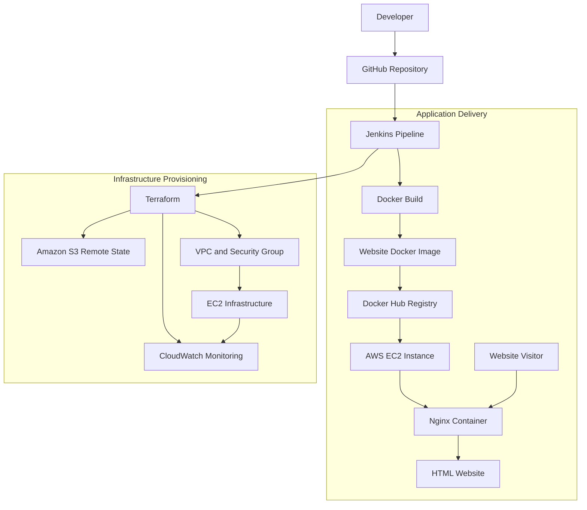

# 🚀 Website Automation — End-to-End DevOps Project

<p align="center">
  <b>Automating website deployment with Jenkins, Docker, Docker Hub, Terraform and AWS</b>
</p>

<p align="center">
  
  
  
  
  
</p>

<p align="center">
  <a href="#-project-overview">Overview</a> •
  <a href="#-architecture">Architecture</a> •
  <a href="#-project-structure">Structure</a> •
  <a href="#-deployment-workflow">Workflow</a> •
  <a href="#-setup-and-execution">Setup</a>
</p>

---

## 📌 Project Overview

**Website Automation** is a hands-on DevOps project that combines Infrastructure as Code (IaC), CI/CD, containerization, and AWS cloud infrastructure to automate the deployment of a static HTML website.

The website is packaged into a Docker image, pushed to Docker Hub through a Jenkins pipeline, and served using Nginx on an AWS EC2 instance.

Terraform manages the AWS infrastructure, while an Amazon S3 bucket stores Terraform's remote state.

### 🎯 Project objectives

- Automate AWS infrastructure provisioning using Terraform.
- Build a Docker image for an HTML website served by Nginx.
- Push container images to Docker Hub using Jenkins.
- Provision AWS resources through reusable Terraform modules.
- Maintain Terraform state in an S3 remote backend.
- Configure CloudWatch monitoring for the EC2 instance.
- Practice a repeatable, version-controlled DevOps workflow.

## 🏗️ Architecture

The project combines two related workflows: **application containerization** and **infrastructure provisioning**.



<details>
<summary><b>🔍 How the architecture works</b></summary>

1. **GitHub:** Stores the source code, Dockerfile, Terraform configuration, and Jenkins pipeline.
2. **Jenkins:** Executes the configured pipeline stages.
3. **Docker:** Builds an image containing the website and its Nginx configuration.
4. **Docker Hub:** Stores the published container image.
5. **Terraform:** Provisions and manages AWS infrastructure.
6. **Amazon S3:** Stores the Terraform state file remotely.
7. **Amazon EC2:** Provides the compute environment for hosting the container.
8. **Nginx:** Serves the HTML page over HTTP.
9. **Amazon CloudWatch:** Supports instance monitoring and configured alerts.

The application deployment and Terraform provisioning are separate responsibilities, even though Jenkins can orchestrate both.

</details>

## 🛠️ Technologies Used

| Technology | Role in this project |
|---|---|
| AWS EC2 | Hosts the website container |
| Amazon VPC | Provides network isolation |
| Amazon S3 | Stores Terraform remote state |
| Amazon CloudWatch | Monitors the EC2 instance |
| Terraform | Provisions infrastructure as code |
| Jenkins | Orchestrates CI/CD stages |
| Docker | Packages the website and Nginx |
| Docker Hub | Stores the container image |
| Nginx | Serves the HTML page |
| HTML | Provides the website content |
| Git and GitHub | Source control and repository hosting |

## 📂 Project Structure

```text
Website-Automation/
│
├── backend/
│   └── Terraform configuration for the S3 backend
│
├── modules/
│   ├── vpc/
│   │   └── VPC, subnet, security group and key configuration
│   ├── ec2/
│   │   └── EC2 instance configuration
│   └── cloudwatch/
│       └── Instance monitoring and alert configuration
│
├── website/
│   └── HTML website files
│
├── Dockerfile
│   └── Instructions for building the website image
│
├── Jenkinsfile
│   └── CI/CD pipeline definition
│
├── main.tf
│   └── Root Terraform configuration and module connections
│
├── vars.tf
│   └── Terraform input variable declarations
│
│
├── output.tf
│   └── Terraform outputs
│
├── .gitignore
│   └── Files excluded from Git
│
└── README.md
    └── Project documentation
```

<details>
<summary><b>📁 backend/ — Remote state bootstrap</b></summary>

This directory contains the Terraform configuration used to initialize or provision the S3 backend infrastructure.

The root Terraform configuration references the following backend settings:

- **Bucket:** `backend-for-webpage-automation`
- **State key:** `webpage/terraform.tfstate`
- **Region:** `us-east-1`

The backend bucket must exist before Terraform can initialize the root configuration using it.

The S3 bucket stores Terraform's state information. It does **not** automatically host the HTML website.

</details>

<details>
<summary><b>📁 modules/ — Reusable infrastructure</b></summary>

The root configuration uses Terraform modules to separate infrastructure into logical components.

**`modules/vpc/`**

- Defines the network environment.
- Provides the public subnet reference used by the EC2 module.
- Supplies the security group and key-pair references.

**`modules/ec2/`**

- Defines the EC2 instance.
- Receives network and security-related values from the VPC module.
- Exposes the instance ID for use by other resources.

**`modules/cloudwatch/`**

- Receives the EC2 instance ID.
- Configures the monitoring resources defined in the module.
- Accepts an alert email variable.

This modular approach makes the infrastructure easier to understand, maintain, and extend.

</details>

<details>
<summary><b>📁 website/ and Dockerfile — Application layer</b></summary>

The `website/` directory contains the HTML website files.

The root `Dockerfile` defines how to package the website for Nginx.

The resulting container image can be run locally or on a compatible server, provided the required container runtime is available.

Example local execution:

```bash
docker build -t my-webpage .
docker run -d --name my-webpage -p 8080:80 my-webpage
```

Open `http://localhost:8080` to test the website if the image serves Nginx on container port 80.

</details>

<details>
<summary><b>📄 main.tf, vars.tf, terraform.tfvars and output.tf</b></summary>

- **`main.tf`:** Configures the AWS provider, S3 backend, and the VPC, EC2, and CloudWatch modules.
- **`vars.tf`:** Declares input variables used by the Terraform configuration.
- **`terraform.tfvars`:** Supplies values for the declared variables.
- **`output.tf`:** Defines the values Terraform exposes after provisioning.

Keeping configuration, input values, and outputs separate makes the infrastructure easier to manage.

</details>

## 🔄 Deployment Workflow

The Jenkinsfile defines the automation pipeline for this project.

### Pipeline stages

| Stage | What it does |
|---|---|
| 1. Docker Login | Authenticates with Docker Hub using Jenkins credentials |
| 2. Docker Image Build | Builds the website image, tags it, and pushes it to Docker Hub |
| 3. Backend Initialization | Runs Terraform initialization and applies the backend configuration from `backend/` |
| 4. Terraform Initialization | Initializes the root Terraform configuration and formats the configuration |
| 5. Terraform Planning | Validates the configuration and generates an execution plan |
| 6. Terraform Execution | Applies the saved Terraform plan |
| 7. Terraform State Check | Lists resources recorded in the Terraform state |

<details>
<summary><b>🐳 Docker build and push commands</b></summary>

The pipeline includes the following Docker operations:

```bash
docker build -t my-webpage .
docker tag my-webpage mohammedarmaan2005/my-webpage
docker push mohammedarmaan2005/my-webpage
```

These commands build the image, assign the Docker Hub repository tag, and publish the image.

The commands do not, by themselves, pull the image onto EC2 or restart a running container. That requires a corresponding deployment step on the target instance.

</details>

<details>
<summary><b>☁️ Terraform execution commands</b></summary>

The pipeline includes these Terraform operations:

```bash
terraform init -reconfigure
terraform fmt
terraform validate
terraform plan -out=tfplan
terraform apply -auto-approve tfplan
terraform state list
```

The backend initialization stage operates in the `backend/` directory. The remaining Terraform stages manage the root configuration.

The S3 backend must be available and correctly configured before the root Terraform initialization can succeed.

</details>

## ⚙️ Setup and Execution

### Prerequisites

- An AWS account with the required IAM permissions.
- Terraform CLI.
- Docker Engine or Docker Desktop.
- Jenkins with Git, Docker CLI, Terraform, and AWS credential support.
- A Docker Hub account.
- Access to the GitHub repository.

### 1. Clone the repository

```bash
git clone https://github.com/Armaan-2005/Website-Automation.git
cd Website-Automation
```

### 2. Configure AWS credentials

Configure credentials for local testing using an appropriate AWS authentication method.

```bash
aws configure
aws sts get-caller-identity
```

For Jenkins, configure the AWS credentials entry referenced by the pipeline.

### 3. Initialize the backend

From the backend directory:

```bash
cd backend
terraform init
terraform plan
```

Review the plan and apply the backend infrastructure configuration when appropriate:

```bash
terraform apply
```

If the backend bucket already exists, verify that it matches the configuration before attempting to create it again.

### 4. Initialize the root configuration

Return to the repository root:

```bash
cd ..
terraform init -reconfigure
terraform fmt
terraform validate
terraform plan
```

Review the plan before provisioning infrastructure.

### 5. Build and test the website image

```bash
docker build -t my-webpage .
docker run -d --name my-webpage -p 8080:80 my-webpage
```

Visit `http://localhost:8080` to test the page locally.

### 6. Run the Jenkins pipeline

Configure the Jenkins job to use this repository and its `Jenkinsfile`.

Ensure that the following credentials are configured in Jenkins:

- `DOCKERHUB_creds` — Docker Hub username and password/token.
- `AWS_credentials` — AWS credentials used by the Terraform stages.

Run the pipeline and review each stage's console output.

**Note:** These are setup instructions, not a guarantee that the current environment has all prerequisites configured or that every stage has completed successfully.

## 🔐 Security Best Practices

- Never commit AWS access keys, secret keys, or Docker Hub passwords.
- Store credentials in Jenkins Credentials rather than hardcoding them.
- Restrict EC2 SSH access to trusted sources.
- Allow HTTP traffic only where needed.
- Use least-privilege IAM policies.
- Protect the S3 Terraform state bucket and enable encryption and versioning where appropriate.
- Keep Terraform state files and sensitive variable files out of Git.
- Review infrastructure changes before applying them.

## 🧹 Cleanup

When you no longer need the test infrastructure, review the resources managed by Terraform and destroy them only if they are safe to remove.

```bash
terraform plan -destroy
terraform destroy
```

Run the commands from the appropriate Terraform configuration directory.

Do not remove the shared S3 backend bucket while Terraform state still depends on it or while other projects are using it.

## 📚 What I Learned

Through this project, I practised:

- Writing and organizing Terraform infrastructure code.
- Connecting reusable Terraform modules.
- Using S3 as a Terraform remote backend.
- Building and publishing Docker images.
- Configuring Jenkins credentials.
- Defining a Jenkins CI/CD pipeline.
- Working with AWS networking and EC2.
- Serving a static website using Nginx.
- Configuring CloudWatch monitoring.
- Troubleshooting infrastructure provisioning and deployment workflows.

## 🚀 Future Improvements

- Automate image deployment and container restart on EC2 after every successful image push.
- Add automated website health checks.
- Introduce manual approval before production infrastructure changes.
- Add Docker image vulnerability scanning.
- Improve CloudWatch alarms and notification handling.
- Add deployment rollback and image versioning.
- Consider using IAM roles instead of long-lived AWS access keys.

---

<p align="center">
  <b>Built to practise real-world DevOps, CI/CD, containerization and AWS infrastructure automation.</b>
</p>
