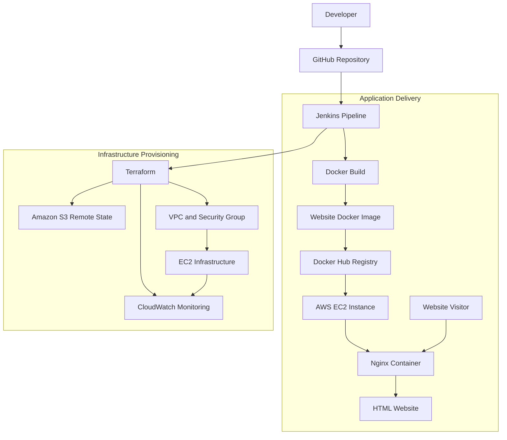

# 🚀 Website Automation — End-to-End DevOps Project

  <b>Automating website deployment with Jenkins, Docker, Docker Hub, Terraform and AWS</b>

  
  
  
  
  

  <a href="#-project-overview">Overview</a> •
  <a href="#-architecture">Architecture</a> •
  <a href="#-project-structure">Structure</a> •
  <a href="#-deployment-workflow">Workflow</a> •
  <a href="#-setup-and-execution">Setup</a>

---

## 📌 Project Overview

**Website Automation** is a hands-on DevOps project that combines Infrastructure as Code (IaC), CI/CD, containerization, and AWS cloud infrastructure to automate the deployment of a static HTML website.

The website is packaged into a Docker image, pushed to Docker Hub through a Jenkins pipeline, and served using Nginx on an AWS EC2 instance.

Terraform manages the AWS infrastructure, while an Amazon S3 bucket stores Terraform's remote state.

### 🎯 Project objectives

- Automate AWS infrastructure provisioning using Terraform.
- Build a Docker image for an HTML website served by Nginx.
- Push container images to Docker Hub using Jenkins.
- Provision AWS resources through reusable Terraform modules.
- Maintain Terraform state in an S3 remote backend.
- Configure CloudWatch monitoring for the EC2 instance.
- Practice a repeatable, version-controlled DevOps workflow.

## 🏗️ Architecture

The project combines two related workflows: **application containerization** and **infrastructure provisioning**.

<b>🔍 How the architecture works</b>

1. **GitHub:** Stores the source code, Dockerfile, Terraform configuration, and Jenkins pipeline.
2. **Jenkins:** Executes the configured pipeline stages.
3. **Docker:** Builds an image containing the website and its Nginx configuration.
4. **Docker Hub:** Stores the published container image.
5. **Terraform:** Provisions and manages AWS infrastructure.
6. **Amazon S3:** Stores the Terraform state file remotely.
7. **Amazon EC2:** Provides the compute environment for hosting the container.
8. **Nginx:** Serves the HTML page over HTTP.
9. **Amazon CloudWatch:** Supports instance monitoring and configured alerts.

The application deployment and Terraform provisioning are separate responsibilities, even though Jenkins can orchestrate both.

## 🛠️ Technologies Used

| Technology | Role in this project |
|---|---|
| AWS
